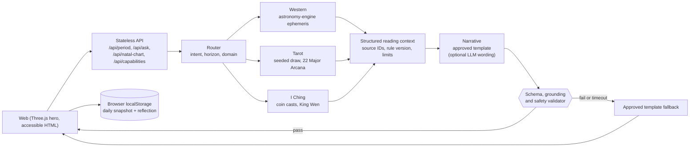

# Celestra · Daily Compass

**A calm daily-reflection ritual built on calculated signals, versioned rules and safe, grounded wording.**

   

> A proof of concept, not a production account system. Astrology-inspired meanings are interpretive and never presented as prediction.

## Tech stack

  

## Reading pipeline

## Where to read more

| Document | Topic |
|---|---|
| [`PRODUCT_CONCEPT.md`](PRODUCT_CONCEPT.md) | Signal, why, action, reflection loop |
| [`ARCHITECTURE.md`](ARCHITECTURE.md) | Full reading flow, failure handling, question flow |
| [`SAFETY.md`](SAFETY.md) and [`DATA_PRIVACY.md`](DATA_PRIVACY.md) | Boundaries for high-stakes questions and personal data |
| [`WEB_PLAN.md`](WEB_PLAN.md) | Pages, data contracts and implementation priority |
| [`poc/README.md`](poc/README.md) | Run it: `npm install`, `npm start`, open `http://localhost:4174` |

---

