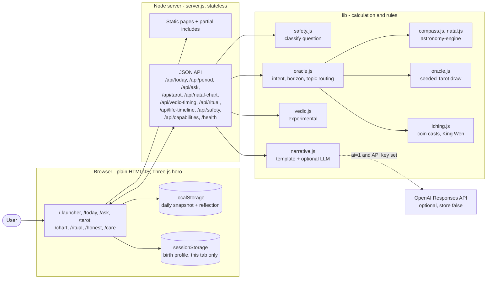
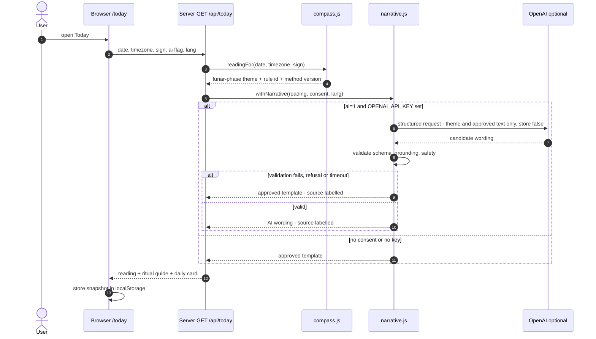
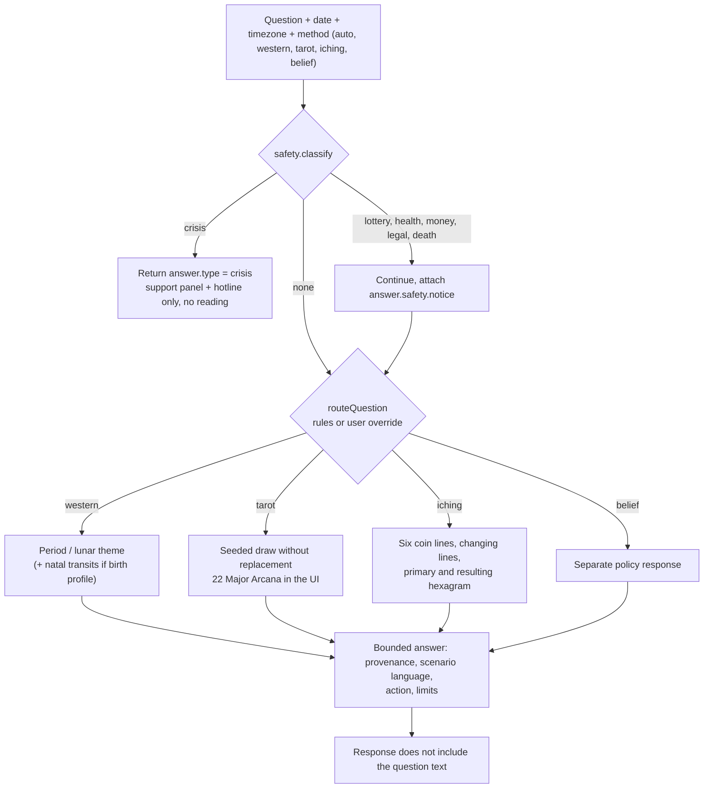
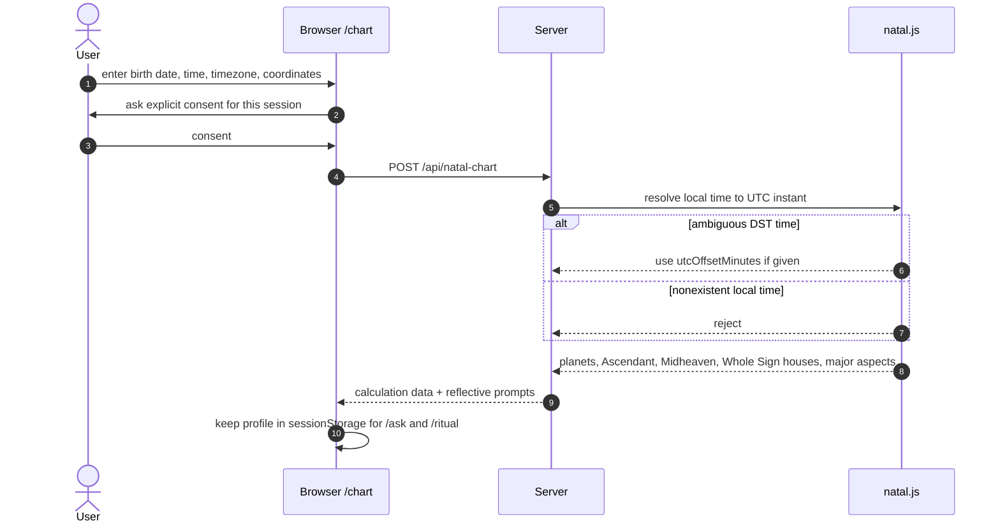
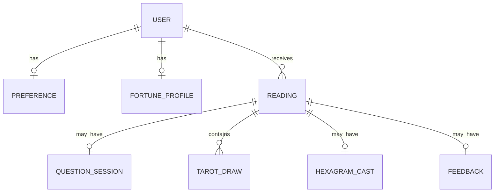

# Celestra: Daily Compass

**A calm daily-reflection ritual built on calculated signals, versioned rules and safe, grounded wording. Western lunar and natal calculation, Tarot, I Ching and an experimental Vedic timing, behind a stateless Node API with a Thai-first web UI.**

     

> **Status: proof of concept, not a production account system.** Astrology-inspired meanings are interpretive and never presented as prediction. The optional LLM wording path has **not been exercised against a live provider** (no API key was supplied during development). Tarot meanings, Vedic timing and natal output are not expert-reviewed or checked against external fixtures; see [Limitations](#security-privacy-and-limitations).

Last updated: 2026-11-03.

---

## Problem

Daily-horoscope products tend to present vague text as fact, store personal data they do not need, and let an LLM invent "predictions". Celestra takes the opposite approach for an adult who wants a brief daily reflection:

- the *signal* is calculated (Sun-Moon geometry, planetary positions, seeded or cryptographic draws),
- the *meaning* comes from versioned rules and approved templates,
- an LLM, if used at all, may only rephrase approved text, and the result is validated,
- the core loop is **Signal -> Why -> Action -> Reflection** (see `SPEC.md`).

## Design principles

| Principle | How it shows up in the code |
|---|---|
| Calculation before language | Rules in `poc/lib/compass.js` (`RULE_VERSION = moonphase-v1`) map the Sun-Moon relative longitude at local noon to one of four themes. |
| LLM only writes text | `poc/lib/narrative.js` rephrases approved text; it sends only the structured theme and rule, never birth data or reflection notes, with `store: false`. |
| Safe fallback | Timeout, refusal, malformed output or validator failure returns the approved template. The UI labels which source was used. |
| Stateless server | No database, no logging of questions, question text is not echoed back. Daily snapshot and reflection live in browser `localStorage`. |
| Explicit consent for birth data | Exact birth time/place are sent only for a requested calculation, kept in page memory (profile on `/chart` in `sessionStorage` for that tab). |
| Transparent randomness | Tarot is deterministic per `date|topic|spread|reshuffle` seed; I Ching uses cryptographic randomness. |
| Honest capabilities | `GET /api/capabilities` lists methods and limitations so the UI cannot imply unsupported precision. |
| Safety boundary | `poc/lib/safety.js` classifies crisis and high-stakes questions (see [Safety](#safety-model)). |

---

## Repository layout

```
AIdailyFortune/
├── poc/                          runnable proof of concept (the code)
│   ├── server.js                 node:http server, JSON API + static pages + partial includes
│   ├── lib/
│   │   ├── compass.js            daily lunar reading, Sun sign, local-noon helpers
│   │   ├── oracle.js             question routing, period readings, Tarot (78-card catalog), I Ching cast
│   │   ├── natal.js              Western tropical natal chart, houses, aspects, transit contacts
│   │   ├── vedic.js              experimental sidereal timing (Lahiri approximation, Vimshottari)
│   │   ├── iching.js             64 King Wen hexagram identification
│   │   ├── life.js               multi-year timeline (up to 10 years)
│   │   ├── ritual.js             life number + weekday ritual guide
│   │   ├── narrative.js          optional OpenAI wording layer + validators
│   │   ├── safety.js             crisis / high-stakes classification, hotline entry
│   │   └── th.js                 Thai strings for planets, signs, topics, rules
│   ├── public/                   plain HTML/CSS/JS, one page per feature, Three.js starfield
│   ├── scripts/build.mjs         esbuild bundle for the Three.js scene
│   ├── scripts/capture.mjs       real-browser check + screenshots (playwright-core)
│   ├── test/                     5 node:test files
│   ├── mockups/                  screenshots
│   └── README.md                 POC run notes and API details
├── design/                       visual prototype and reference screens
├── docs/progress/                session work logs
└── *.md                          design and submission documents (see table below)
```

## Documentation map

| Document | Topic |
|---|---|
| [`PRODUCT_CONCEPT.md`](PRODUCT_CONCEPT.md) | Signal, why, action, reflection loop |
| [`SPEC.md`](SPEC.md) | User, scope, acceptance for the POC |
| [`ARCHITECTURE.md`](ARCHITECTURE.md) | Full reading flow, failure handling, question flow |
| [`SYSTEM_STATUS.md`](SYSTEM_STATUS.md) | Capability-by-capability status table and next milestones |
| [`SAFETY.md`](SAFETY.md) and [`DATA_PRIVACY.md`](DATA_PRIVACY.md) | Boundaries for high-stakes questions and personal data |
| [`ERD.md`](ERD.md) and [`ANSWER.md`](ANSWER.md) | Proposed production data model and the submission answer |
| [`WEB_PLAN.md`](WEB_PLAN.md) | Pages, data contracts and implementation priority |
| [`poc/README.md`](poc/README.md) | Run it and API details |

---

## Tech stack

<p align="center">
  
</p>

| Layer | Choice (from `poc/package.json` and code) |
|---|---|
| Runtime / server | Node.js ES modules, built-in `node:http` (no web framework), default port 4174 on 127.0.0.1 |
| Astronomy | `astronomy-engine` 2.1.19 (pinned, MIT) |
| Frontend | Plain HTML, CSS and JavaScript, no framework; `three` ^0.186.0 starfield bundled with `esbuild` ^0.28.2 |
| Fonts | Self-hosted Anuphan, Noto Serif Thai, IBM Plex Mono (licences in `public/fonts/LICENSES.md`) |
| Optional AI | OpenAI Responses structured output; `OPENAI_API_KEY`, optional `OPENAI_MODEL` (default `gpt-4o-mini`) |
| Tests | `node --test`; `playwright-core` ^1.63.0 for the capture script |
| Language | Thai-first UI; English removed from the web port |

---

## System architecture



## Flow 1: Daily reading with optional AI wording



## Flow 2: Asking a question (POST /api/ask)



## Flow 3: Natal chart with consent



---

## API

All endpoints are stateless; JSON bodies are limited to 8192 bytes.

| Method | Path | Purpose |
|---|---|---|
| GET | `/health` | `{ ok: true }` |
| GET | `/api/capabilities` | Methods available and explicit limitations |
| GET | `/api/today` | Daily lunar reading (optional `ai=1`, `lang`) + ritual guide + daily Tarot card |
| GET | `/api/reading` | Original daily endpoint with optional AI wording |
| GET / POST | `/api/period` | `date`, `timezone`, `topic` (general, love, career, study, money), `horizon` (day 1, week 7, month 30, year 365). POST can add a `birthProfile` for transit contacts |
| POST | `/api/ask` | `{ question, date, timezone, method }`; also accepts `topic`, `horizon`, `reshuffle` |
| POST | `/api/tarot` | Seeded Tarot spread (general, career, study, money, relationship); `reshuffle > 1` is rejected with HTTP 400 |
| POST | `/api/natal-chart` | `birthDate`, `birthTime`, `timezone`, `latitude`, `longitude`, optional `utcOffsetMinutes` |
| POST | `/api/vedic-timing` | Experimental sidereal placements, nakshatra/pada, Vimshottari Mahadasha and three upcoming periods |
| POST | `/api/ritual` | Ritual guide (life number, weekday) |
| POST | `/api/life-timeline` | Multi-year timeline (up to 10 years) |
| GET | `/api/safety` | Hotline entry (flagged `verified: false` until checked against an official source) |

Pages are served at `/`, `/today`, `/ask`, `/tarot`, `/chart`, `/ritual`, `/honest` and `/care`; files and folders starting with `_` are never served directly.

## Proposed production data model

The POC has no database. `ERD.md` proposes a registered-user product; the entities are summarized here (see `ANSWER.md` for the submission version):



Daily readings would be unique per user, date and method version; raw question text is ephemeral by default; religion or deity preference is not stored.

---

## How to run

From `poc/README.md` and `poc/package.json`:

```bash
cd poc
npm install
npm start          # runs the build (esbuild) via prestart, then node server.js
```

Open <http://localhost:4174> (the server binds `127.0.0.1`; override with `PORT`).

Optional AI wording (off unless the footer toggle sends `ai=1` **and** the key is set):

```bash
OPENAI_API_KEY=... npm start     # optional: OPENAI_MODEL (default gpt-4o-mini)
```

## Testing

```bash
cd poc
npm test           # node --test: compass, oracle, safety, tarot-seed, ui-static
npm run capture    # builds, drives a real browser, regenerates screenshots
```

The test files cover calculation and rules, routing and answers, safety classification, Tarot seed determinism and static UI checks. `npm run capture` also checks overflow, console errors, absence of Google Fonts requests, crisis/warn paths and Tarot determinism across reload (needs a local Chrome via `playwright-core`; ASSUMPTION about the exact browser setup, see `scripts/capture.mjs`). I have not run any of these commands; `SYSTEM_STATUS.md` states browser verification covers desktop core flows and mobile landing/daily without overflow, and does not establish production readiness.

---

## Safety model

- Product is framed as entertainment and reflection; uses "may" and "consider", never guaranteed predictions (`SAFETY.md`).
- Crisis wording returns `answer.type === 'crisis'` with a support panel and hotline only; **no reading is produced**.
- Lottery, health, money, legal and death questions still get a reading with an attached notice.
- Narratives are validated (schema, grounding, safety) before display; failure falls back to the approved template.
- The hotline number (1323) is marked `verified: false` until checked against an official source.
- The safety classifier is rule-based and needs broader multilingual adversarial evaluation before production.

## Security, privacy and limitations

| Area | Detail |
|---|---|
| Data stored | Server: none. Browser: daily snapshot and optional reflection in `localStorage` (deletable from the footer); birth profile in `sessionStorage` for the tab only. |
| Data sent | Birth details only for a requested calculation and only after consent; questions go to the API for routing but are not logged or echoed. Reflection notes are never sent to the narrative model. |
| External calls | None by default (fonts are self-hosted). Only when `ai=1` and `OPENAI_API_KEY` is set does the server call OpenAI, with theme and approved text only. |
| Secrets | Read from the environment; `.env` is gitignored. |
| Not exercised | Live OpenAI call; natal results vs. external chart fixtures; Vedic output vs. a practitioner. |
| Tarot | 78-card compositional catalog (the UI draws the 22 Major Arcana); meanings are product interpretations, not canonical or expert-reviewed. |
| I Ching | Hexagram identity and King Wen mapping only; no classical judgement or line texts. |
| Vedic | Experimental mean Lahiri IAE 1989 approximation; no Antardasha, no event prediction. |
| Natal | Whole Sign houses only. |
| Accounts / notifications | Not implemented (design only). |
| Scientific claim | No claim that astrology predicts events; no NASA data is claimed to validate it. |
| PDPA | Design notes in `DATA_PRIVACY.md`; retention and legal compliance are explicitly left to product/privacy review. |

## Credits and attributions

- Astronomical calculation: [`astronomy-engine`](https://github.com/cosinekitty/astronomy) (MIT).
- Fonts: see `poc/public/fonts/LICENSES.md`.
- Tarot and zodiac art assets under `poc/public/assets/` and `design/prototype/assets/`; licence/source of these images is not stated in the repo files I read (verify before redistribution).
